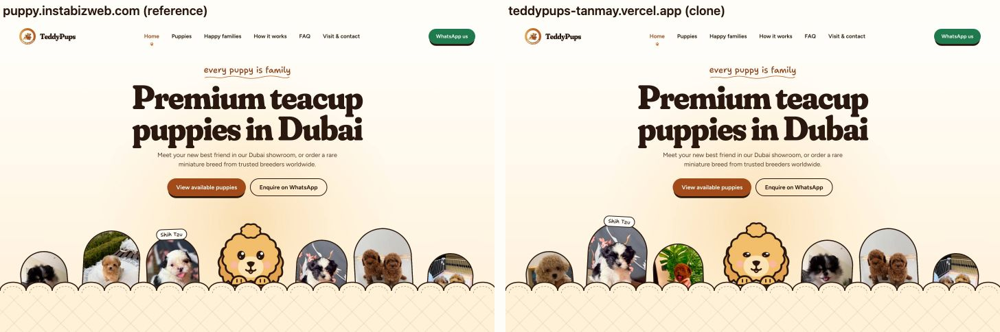
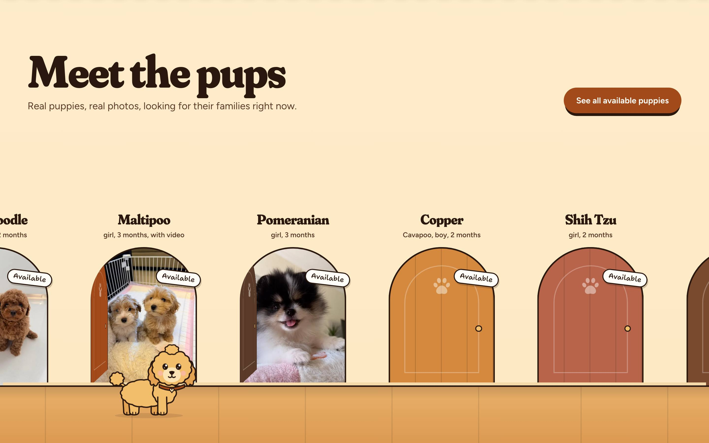
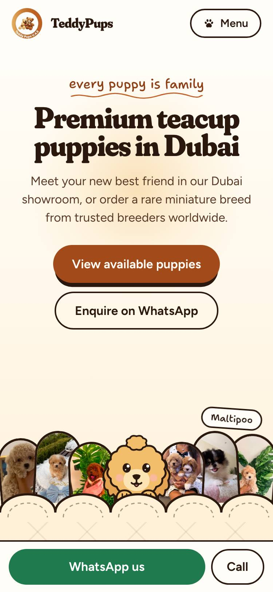
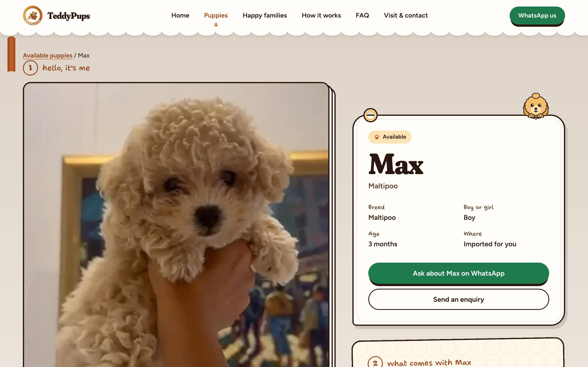
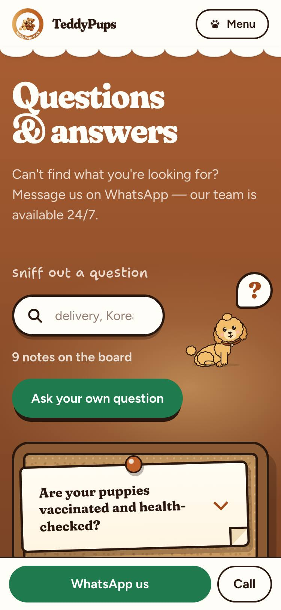

# TeddyPups U.A.E. — a faithful clone

[](https://github.com/Tanmay-Singh-24/teddypups-clone/actions/workflows/ci.yml)

**Live:** https://teddypups-tanmay.vercel.app · **Reference:** https://puppy.instabizweb.com

A pixel-faithful rebuild of the TeddyPups U.A.E. puppy site, built for the Insta Biz Web technical assignment: all 49 pages, the homepage's eight-scene scroll story, the pinned hallway of doors, the WhatsApp-style journey, the page curtain and Teddy, the mascot who walks the homepage with you.



| Desktop | Phone |
|---|---|
|  |  |
|  |  |

## How close is it?

Fidelity was measured, not eyeballed:

- **Layout:** every element box on every page was compared with the live site at 375 and 1440 px (and 768/1024 for the shell and homepage) using a script that diffs `offsetLeft/Top/Width/Height` in both tabs. Page heights are identical.
- **Pixels:** `npm run shots` screenshots both sites and scores the difference: every main page is within 0.4% at both widths, and what's left is things that move (the cycling lineup, the live mascots, twinkling stars).
- **Behaviour:** filter parameters and counts, FAQ search results, the hallway's track position and open doors at given scroll points, the chat's replay state and the pup actor's position, scale and scene at 12 desktop and 10 phone scroll points all match the live site.

## Stack

| | Why |
|---|---|
| **Next.js 16.4** (App Router, `cacheComponents`, partial prefetching) | The reference is a Next 16 App Router site; the same router gives the same prerendered pages, streaming and navigation behaviour. |
| **React 19.3**, **TypeScript** | Server Components for the static scenes, small client islands for behaviour. |
| **Tailwind CSS v4** + component CSS | Utilities for layout; one CSS file per component keeps the reference's `tp-*` class vocabulary so every value can be cross-checked against its compiled CSS. |
| **Lenis** | The reference's smooth scroll (off for reduced motion and inside dialogs). |
| **Motion** | Layout animation in the puppy grid, the gallery's page turn, the sprung hallway track. |
| **zod** | Validation in the enquiry Server Action. |
| **Playwright** | End-to-end tests and the screenshot script. |
| **Vercel** | Hosting; every push to `main` deploys. |

## Project structure

```
src/
  app/                  routes (/, /puppies, /puppies/[slug], /gone-home, /happy-families,
                        /how-it-works, /faq, /contact), not-found, errors, sitemap, robots
    actions/enquiry.ts  the one Server Action behind both forms
  components/
    home/               the eight homepage scenes (Hero, MeetHall, Paths, JourneyChat, Passport, Dusk, Night, HomeHouse)
    puppies/ families/ how/ faq/ forms/   page-specific pieces
    layout/             header, mobile menu, footer, bottom bar, skip link
    motion/             Lenis, page curtain, reveal scope, pup stops, reduced-motion hooks
    pup/                the mascot engine: puppet (rig driver), tricks, stage maths, director
    art/                SVG artwork: Teddy's rig, the runner dog, quilt, paws, flight, icons
    ui/                 Photo, the shared photo viewer
  content/              typed accessors over data/*.json (puppies, families, FAQs, homepage media)
  lib/                  WhatsApp links, puppy wording rules
  styles/components/    one CSS file per component, imported from app/globals.css
scripts/                content extraction, media download, SVG dump, content verification, screenshots
e2e/                    Playwright specs
docs/                   PLAN.md (the spec), HANDOVER.md (state of the build), PROMPTS.md (every AI prompt)
public/media/           the reference's 205 photos and videos, same paths
```

## Run it

```bash
npm i
npm run dev            # http://localhost:3000
```

| Script | |
|---|---|
| `npm run build` / `npm start` | production build and server |
| `npm run lint` / `npm run typecheck` | ESLint, `tsc --noEmit` |
| `npm run test:e2e` | Playwright against `next start` on port 3200 (build first; `npx playwright install chromium` once) |
| `npm run shots` | screenshots of both sites at 375 and 1440 into `docs/shots/` with a difference score (`BASE=` a running build) |
| `npm run content:extract` · `content:media` · `content:svgs` · `content:verify` | rebuild the content layer from a local capture of the reference and check every string |

Optional environment variables: `NEXT_PUBLIC_SITE_URL` (absolute URLs in metadata, sitemap and WhatsApp links), `RESEND_API_KEY` + `CONTACT_TO_EMAIL` (email enquiries; without them they are logged).

## How it was built

1. **Recon.** The reference was captured page by page: the server HTML of all 49 sitemap URLs, the compiled CSS (pretty-printed), the JS chunks, fonts and their variation axes, screenshots, and every section measured at four widths.
2. **Spec.** That became [`docs/PLAN.md`](docs/PLAN.md): routes, design tokens, the shell, a scene-by-scene homepage spec, the inner pages, forms, the motion systems, phases, priorities and cut lines.
3. **Phases.** Ten prompts, P0–P8 (P6 split in two), each run as its own Claude Code session or turn, each ending with lint, typecheck, build, a measured comparison against the live site, small commits and an update to [`docs/HANDOVER.md`](docs/HANDOVER.md) so the next session started from facts.

| Phase | |
|---|---|
| P0–P1 | scaffold, fonts, tokens, metadata; content extracted from the reference's payloads and verified string by string; 205 media files |
| P2 | header, menu dialog, footer, bottom bar, Lenis, not-found and error pages, Teddy's rig |
| P3 | the eight homepage scenes, static |
| P4 | `/puppies` with URL filters, 42 profiles, `/gone-home` |
| P5 | `/happy-families`, `/how-it-works`, `/faq`, `/contact`, the Server Action |
| P6a | scroll motion: reveals, hero lineup, pinned hallway, chat replay, scroll-driven stamps, sun and doors |
| P6b | page curtain, the pup actor, live mascots |
| P7 | Playwright, CI, screenshot diffing, Lighthouse |
| P8 | this README, live check, submission |

## Decisions and challenges

**The pup engine.** Teddy is one SVG rig (`components/art/teddy/rig.ts`): part shapes plus twelve poses expressed as a handful of numbers, resolved by `frame(pose, motion)` into a transform per part. The same rig draws every static mascot on the server, so the page looks right with no JavaScript. On the client a `Puppet` rewrites those parts every frame: poses blend, facing turns, ears and bounces are springs, the eyes blink and follow the pointer. On the homepage the director measures each `[data-pup-stop]`, gives it a range of scroll where Teddy sits there, and between ranges moves him along an S-curve (with hop arcs in and out of hiding places), stamping paw prints as he walks. Stops inside the sticky hallway get a pinned track; on phones he switches to a "lane" mode and peeks up from alternating bottom corners. It's scroll-scrubbed rather than time-based, so it never lags behind a fast scroll.

**The pinned hallway.** From 1024 px the Meet section becomes a sticky stage whose height is `100vh + 0.8 × (track overflow)`; Motion's `useScroll` → `useSpring(170/32/0.35)` maps progress to the track's `x`, the floor planks follow through `--floor-x`, and each door swings open as it passes 36% of the viewport. Door width is solved from the stage height so the hallway always fits. Below 1024 px, or with reduced motion, it is a grid of doors that open as they scroll in.

**The page curtain with the App Router.** Rather than wrapping every link, one capture-phase click listener intercepts plain left-clicks to other internal pages, covers (300 ms), calls `router.push`, and lifts on the frame after `usePathname` changes. It handles modified clicks, new tabs, hash links, back/forward (a quick "snap"), keyboard activation (focus returns to `#main`) and a 6 s safety lift. Entrance animations wait for it to lift.

**Safari and older browsers.** Scroll-driven effects use `animation-timeline: view()` inside `@supports`, exactly as the reference does; without it they rest on their final frame, which is also what reduced motion shows. Checked on Safari.

**A static content layer instead of a CMS.** The reference's content (15 available and 27 gone-home puppies, 64 family photos, 9 FAQs, homepage media) was extracted from its server payloads into JSON with typed accessors, and `content:verify` checks every generated title, description, label and WhatsApp message against all 42 reference profiles. No runtime dependency, and every page prerenders.

**Forms.** One Server Action serves the puppy enquiry and the contact letter: zod validation, a honeypot that pretends to succeed, per-field errors with the values kept (the forms submit from `onSubmit` so React doesn't reset them), `method="post"` so nothing reaches the URL before hydration, the reference's success states and the contact page's post-box animation. Email goes through Resend's HTTP API only when a key is set.

**Next 16 specifics.** `export const dynamicParams` fails the build under Cache Components, and an unknown slug first streamed a 200 shell before `notFound()`; `export const ensureStatic = "navigation"` makes it a real 404 on the first request. Routes stay mounted but hidden after navigation (React `<Activity>`), so every effect (Lenis, the director, dialogs) is written to clean up and re-run.

**Images.** 205 media files, served through `next/image` with tight `sizes`, blur placeholders, dominant-colour backdrops and focal points mapped to `object-position`; video posters also go through the optimizer.

## Testing

```bash
npm run lint && npm run typecheck && npm run build
npm run test:e2e
```

The Playwright suite (16 tests) covers: all 49 sitemap routes return 200 with one h1 and no console errors; the LOST 404; desktop navigation through the curtain; the phone menu dialog and bottom bar; filters ↔ URL and counts; the gallery, viewer and prev/next pups; FAQ search highlighting and auto-expanding; both forms from errors to success; the pup actor booting; reduced motion (no curtain, actor, pinning or replay); the skip link and visible focus rings. CI runs install, lint, typecheck, build and Playwright on every push and pull request.

Lighthouse (local production build): accessibility **100**, best practices **100**, performance **97–99** desktop and **77–82** mobile (the reference scores 72 and 68). SEO is lower only because the clone is deliberately `noindex`.

## Deployment

Vercel builds every push to `main` (preview deployments for pull requests). `NEXT_PUBLIC_SITE_URL` is set in production; production responses carry security headers (CSP, frame, content-type, referrer and permissions policies) from `next.config.ts`.

## AI usage

Built with **Claude Code** (desktop app) running **Claude Opus**: planning at effort *max*, building at effort *high*. Every prompt is logged verbatim, in order, with times, in [`docs/PROMPTS.md`](docs/PROMPTS.md): the planning prompt, the ten phase prompts and every follow-up message. The AI wrote the code; I steered it through the spec, reviewed each phase against the live site (measured box by box, then screenshot-diffed), and kept `docs/HANDOVER.md` as the single source of truth between sessions. Reference CSS and JS were read as specifications only; all components, styles and behaviour were written for this project.

## Credits and disclaimer

Educational clone of puppy.instabizweb.com built for the Insta Biz Web technical assignment. All media, artwork and brand content belong to their owners. The site is noindexed.
